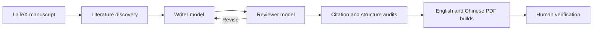

> Update 2026-10-24: [v4.1 evidence and delivery gates](reviewforge-runtime/README_V4_1_ZH.md). Existing v4 commands remain supported.

# ReviewForge

**Research-review automation · Windows Runtime + ChatGPT Skill**

   

**English** | [简体中文](README.zh-CN.md)

**AI-assisted scientific review writing, literature discovery, multi-model peer review, and bilingual LaTeX publishing.**

[中文使用指南](reviewforge-runtime/README_V4_ZH.md) · [Windows Runtime](reviewforge-runtime/) · [ChatGPT Skill](reviewforge/) · [Limitations](reviewforge-runtime/LIMITATIONS.md) · [Light-skills integration](reviewforge-runtime/LIGHT_INTEGRATION.md)

> **Project status:** v4 source code and ChatGPT skill are available. This is a research-assistance workflow, not an autonomous scientific fact checker or a guarantee of publication-ready manuscripts.

## At a glance



[Workflow demo and release notes](docs/DEMO.md) · [中文快速上手](README.zh-CN.md)

## Overview

ReviewForge combines a reusable **ChatGPT Skill** for research-review workflows with a separate **Windows Python Runtime** for repeatable, checkpointed manuscript processing. It is designed to help researchers develop substantive literature reviews, identify unsupported claims, compare modeling approaches, improve manuscript structure, and produce bilingual LaTeX documents.

The included example workflow targets **hybrid modeling of microbial fermentation**, particularly dynamic prediction under changing feeding and induction policies. The approach can be adapted to other scientific fields.

## Features

| Capability | Implementation |
| --- | --- |
| Literature discovery | Searches OpenAlex and cross-checks DOI registration through Crossref |
| Reference management | Deduplicated metadata, BibTeX export, search trace and citation-count audit |
| Multi-model collaboration | Configurable writer and independent reviewer via a compatible API provider |
| Manuscript editing | Section-by-section revision while protecting LaTeX structure and the original |
| Bilingual output | English and Chinese LaTeX, with local XeLaTeX/latexmk PDF compilation |
| Long-running workflow | Up to nine hours per run, checkpoints, and resume support |
| Quality checks | Structured reports for reference thresholds, citation consistency and build status |
| ChatGPT Skill | Reusable research synthesis, critique and evidence-review instructions |

**Evidence boundary:** DOI registration verifies bibliographic metadata, **not** whether a paper supports a specific scientific claim. A bibliography with 60 entries is not equivalent to 60 relevant, verified citations in the manuscript. Human source checking remains necessary.

## Repository structure

```text
ReviewForge/
├── reviewforge/                       # ChatGPT Skill
│   ├── SKILL.md
│   ├── agents/openai.yaml
│   └── references/
├── reviewforge-runtime/               # Windows/Python application
│   ├── README_V4_ZH.md                # Detailed Chinese guide
│   ├── reviewforge_v4.py              # v4 CLI
│   ├── import_project.py              # LaTeX project intake
│   ├── setup_secret.bat                # Local API configuration
│   ├── check_connection.bat
│   ├── check_review_v4.bat
│   ├── start_review_v4_9h.bat
│   ├── resume_review_v4.bat
│   ├── tests/
│   └── workspace/                      # Local manuscript inputs
├── README.md
└── .gitignore
```

## Quick start — Windows Runtime

### 1. Prerequisites

- Windows 10/11 with Python 3.10+ and Git
- A configured API provider supporting the writer/reviewer models
- [MiKTeX](https://miktex.org/download) or another TeX installation with `xelatex` and `latexmk` for PDF output

Clone the project and enter the runtime directory:

```powershell
git clone https://github.com/xuyuchen231-stack/ReviewForge.git
cd ReviewForge\reviewforge-runtime
```

### 2. Configure credentials locally

Run `setup_secret.bat`, then `check_connection.bat`. Credentials are saved locally and **must not** be committed. The default workflow describes MiMo for writing and DeepSeek for independent review; actual model IDs and access depend on your provider.

### 3. Import an existing LaTeX manuscript

Copy your complete LaTeX project, including figures, `.bib`, and any required `.sty` files, into the local workspace. You can use:

```powershell
py import_project.py "C:\path\to\paper\main.tex"
```

The main manuscript is expected at `workspace/original.tex`. Keep an independent backup of unpublished work.

### 4. Check, run, and resume

Double-click `check_review_v4.bat` to inspect the environment. Then start `start_review_v4_9h.bat`; if interrupted, use `resume_review_v4.bat`.

Alternatively, use the CLI:

```powershell
py reviewforge_v4.py preflight
py reviewforge_v4.py discover --minimum 60
py reviewforge_v4.py run --hours 9 --minimum 60
py reviewforge_v4.py resume --minimum 60
py reviewforge_v4.py audit --minimum 60
py reviewforge_v4.py compile
```

The minimum of 60 is an example project target, **not** a general journal requirement. If the manuscript fails the threshold, the audit reports that failure rather than fabricating citations.

### 5. Review outputs

Inspect the local `workspace/reports/` directory for literature, final-audit and compilation reports. On a successful TeX build, expected files include:

```text
workspace/output/review_en.pdf
workspace/output/review_zh.pdf
```

These files are only produced when the relevant stages succeed. A successful PDF build does not establish scientific validity or journal readiness.

For detailed installation and troubleshooting, see **[README_V4_ZH.md](reviewforge-runtime/README_V4_ZH.md)**.

## Install the ChatGPT Skill

The `reviewforge/` directory contains the skill definition in `SKILL.md`, supporting guidance in `references/`, and agent metadata in `agents/openai.yaml`. Import or install this folder in an environment that supports custom skills. Availability and installation steps depend on your ChatGPT environment.

The Skill helps structure research, evidence assessment and manuscript critique **within a conversation**. It does not itself execute a local Windows program or continue working after the conversation ends. Use the Runtime for local unattended processing.

## Research workflow

```text
Scope and review question
         |
Literature discovery + DOI metadata checks
         |
Claim/evidence review + source selection
         |
Section-by-section revision (writer)
         |
Independent model review (reviewer)
         |
Citation and LaTeX consistency audits
         |
English + Chinese TeX / PDF builds
         |
Human scientific verification
```

### What the checks do not prove

- Metadata matches do not validate a paper's experiments, conclusions or relevance.
- Automated review does not replace checking primary sources and quantitative claims.
- Cross-condition generalization must be evaluated on genuinely unseen operating histories.
- LaTeX compilation may require missing fonts, packages, figures or project-specific adjustments.
- The nine-hour limit is a maximum execution window, not a promise of continuous productive work.

## Tests

From `reviewforge-runtime/`:

```powershell
py -m unittest discover -s tests -v
```

## Privacy and security

The repository is public. Never push API keys, `.env`, unpublished manuscripts, confidential evidence, personal data or generated workspaces. API-based writing and review can send manuscript excerpts to your configured provider; check its privacy terms before submitting sensitive work.

## Acknowledgments

ReviewForge adapts workflow ideas from [Light-skills](https://github.com/Light0305/Light-skills) under its MIT license. This is an independent lightweight integration, **not** a complete port of its skills or an official affiliated project. See [LIGHT_INTEGRATION.md](reviewforge-runtime/LIGHT_INTEGRATION.md) and [THIRD_PARTY_NOTICES.txt](reviewforge-runtime/THIRD_PARTY_NOTICES.txt).

## Examples, screenshots and release notes

See [docs/DEMO.md](docs/DEMO.md) for an example command sequence, expected report locations, architecture diagram and v4 source-snapshot notes. Actual screenshots and PDF previews will be added only after a reproducible run using non-sensitive sample data; none are presented as completed results.

## Further reading

- [中文完整操作说明](reviewforge-runtime/README_V4_ZH.md)
- [Runtime limitations](reviewforge-runtime/LIMITATIONS.md)
- [Research review guidance](reviewforge/SKILL.md)
- [Third-party notices](reviewforge-runtime/THIRD_PARTY_NOTICES.txt)
