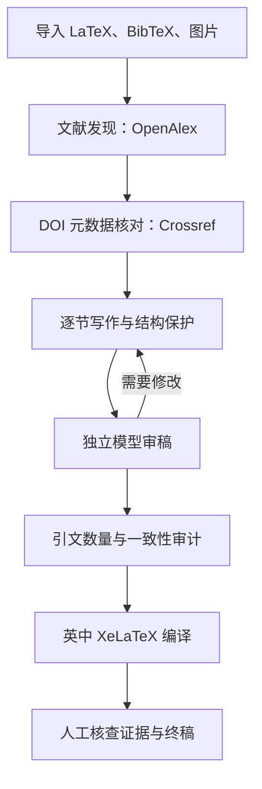

# ReviewForge · 中文指南

[English](README.md) · [快速开始](#快速开始) · [工作流程](#工作流程) · [常见问题](#常见问题)

> 面向科研综述写作的 AI 辅助工具：文献元数据检索、双模型写作与审稿、逐节修订、引用审计、英中 LaTeX/PDF 输出。

## 两种使用方式

| 方式 | 适合任务 | 入口 |
| --- | --- | --- |
| ChatGPT Skill | 在对话中分析综述结构、比较文献、审查论证与修改稿件 | [reviewforge/SKILL.md](reviewforge/SKILL.md) |
| Windows Runtime v4 | 在自己的电脑上批量处理 LaTeX 项目、记录检查点、编译 PDF | [运行程序](reviewforge-runtime/README_V4_ZH.md) |

**注意：** Skill 本身不能在电脑上无人值守运行九小时；需要使用单独的 Windows Runtime。

## 快速开始

安装 Python 3.10+、Git，以及用于编译 PDF 的 MiKTeX（需可调用 `xelatex`、`latexmk`）。

```powershell
git clone https://github.com/xuyuchen231-stack/ReviewForge.git
cd ReviewForge\reviewforge-runtime
```

按顺序运行：

1. `setup_secret.bat` — 本地配置 API 凭据。
2. `check_connection.bat` — 检查模型连接。
3. `py import_project.py "C:\path\to\paper\main.tex"` — 导入完整论文工程。
4. `check_review_v4.bat` — 环境预检。
5. `start_review_v4_9h.bat` — 启动流程；中断后使用 `resume_review_v4.bat`。

详细参数、输出目录与升级说明见 [Windows 中文操作手册](reviewforge-runtime/README_V4_ZH.md)。

## 工作流程



## 项目结构

```text
ReviewForge/
├── README.md                    英文主页
├── README.zh-CN.md              本文件
├── docs/                        运行示例与发布说明
├── reviewforge/                  ChatGPT Skill
│   ├── SKILL.md
│   └── references/
└── reviewforge-runtime/          Windows/Python 程序
    ├── README_V4_ZH.md
    ├── reviewforge_v4.py
    ├── start_review_v4_9h.bat
    ├── resume_review_v4.bat
    └── tests/
```

## 输出与验收

程序预期在本地生成 `workspace/reports/` 中的检查报告；当 LaTeX 编译成功时，PDF 位于 `workspace/output/review_en.pdf` 和 `review_zh.pdf`。请以实际运行日志为准。

**文献数量目标不等于质量证明。** DOI 能核对论文的书目信息，但不能证明其支持稿件中的具体论断。至少 60 篇引用是示例研究任务的目标，而不是所有综述或期刊的硬性要求。

## 常见问题

**能直接输入 Word 或 PDF 吗？** 当前 v4 的主入口要求完整 LaTeX 项目；请先转换或整理为 `main.tex` 和关联资源。

**不安装 LaTeX 能运行吗？** 可进行部分前置步骤，但无法保证本地 PDF 编译。

**API 密钥能上传 GitHub 吗？** 不可以。不要提交 `.env`、未发表论文、内部数据、私人工作区或生成输出。调用第三方模型可能会将稿件内容传输给配置的服务商。

**生成了 PDF 就能投稿吗？** 不能。必须人工核查原始论文、公式、数值、引用和目标期刊要求。

## 致谢

工作流设计参考 [Light-skills](https://github.com/Light0305/Light-skills)（MIT 许可）。本项目是独立实现，并非该项目的官方发行版或完整复刻。详见 [整合说明](reviewforge-runtime/LIGHT_INTEGRATION.md) 与 [第三方声明](reviewforge-runtime/THIRD_PARTY_NOTICES.txt)。
