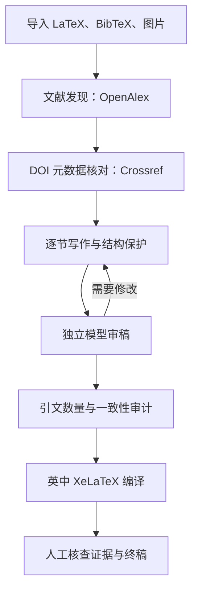

> 2026-11-03 更新：[证据优先的科学大修流程](reviewforge-runtime/README_MAJOR_REVISION_ZH.md)。统一研究事实、公开全文补取、证据矩阵、七章重构及整篇原句核查；用于事实矛盾、重复过多和综合不足。旧的语言凝练命令不能替代本流程。

# ReviewForge · 中文指南

[English](README.md) · [快速开始](#快速开始) · [工作流程](#工作流程) · [常见问题](#常见问题)

> 面向科研综述写作的 AI 辅助工具：文献元数据检索、双模型写作与审稿、逐节修订、引用审计、英中 LaTeX/PDF 输出。

## 项目简介

**ReviewForge 将 AI 辅助文献综述从“一次性生成文本”升级为可追踪、可审计、可恢复的科研工作流。** 它串联 OpenAlex 文献发现、Crossref DOI 元数据核验、LaTeX 章节级修订、模型审稿、引用一致性检查，以及中英文 LaTeX/PDF 输出。长时间任务可记录检查点并在中断后恢复，最终的科学事实核查和投稿判断仍由研究者完成。

**自行接入 API（Bring Your Own API）。** ReviewForge 不提供内置 API Key、托管模型服务或模型调用额度。用户自行配置兼容接口的 API Key、HTTPS Base URL，以及写作、审稿和备用模型的准确 ID。建议写作与审稿使用不同模型进行交叉审查；模型可用性、价格及兼容性取决于所选服务商。

## 自定义 API 与模型

进入 `reviewforge-runtime/`，运行 `setup_secret.bat` 在本地配置密钥，再运行 `check_connection.bat` 测试写作和审稿角色。也可以编辑 `%USERPROFILE%\\.reviewforge\\credentials.env`（或被 Git 忽略的本地 `.env`）：

```dotenv
RF_BASE_URL=https://your-compatible-provider.example/v1
RF_API_KEY=your_private_api_key
RF_WRITER_MODEL=your_writer_model_id
RF_REVIEWER_MODEL=your_reviewer_model_id
RF_FALLBACK_MODEL=your_fallback_model_id
```

仓库的 `.env.example` 仅为配置模板，并不附带可用的 API 服务。**请根据自行选择的服务商填写 Base URL 和模型 ID**，不同平台的模型名称不一定相同。API Key 不代表有权调用平台全部模型；请先检查额度、数据使用条款及模型连通性。不要将真实密钥提交到 GitHub。

## 两种使用方式

| 方式 | 适合任务 | 入口 |
| --- | --- | --- |
| ChatGPT Skill | 在对话中分析综述结构、比较文献、审查论证与修改稿件 | [reviewforge/SKILL.md](reviewforge/SKILL.md) |
| Windows Runtime v4 | 在自己的电脑上批量处理 LaTeX 项目、记录检查点、编译 PDF | [运行程序](reviewforge-runtime/README_V4_ZH.md) |

**注意：** Skill 本身不能在电脑上无人值守运行九小时；需要使用单独的 Windows Runtime。

## 快速开始

安装 Python 3.10+、Git，以及用于编译 PDF 的 MiKTeX（需可调用 `xelatex`、`latexmk`）。

```powershell
git clone https://github.com/xuyuchen231-stack/ReviewForge.git
cd ReviewForge\reviewforge-runtime
```

按顺序运行：

1. `setup_secret.bat` — 本地配置 API 凭据。
2. `check_connection.bat` — 检查模型连接。
3. `py import_project.py "C:\path\to\paper\main.tex"` — 导入完整论文工程。
4. `check_review_v4.bat` — 环境预检。
5. `start_review_v4_9h.bat` — 启动流程；中断后使用 `resume_review_v4.bat`。

v4 的长文本请求使用最多 900 秒的路由总预算和最多 300 秒的单次响应预算，
实际时限取决于候选服务商、模型和任务剩余时间。HTTPS 建连阶段最多等待 15 秒。
仅在确认请求尚未发送的建连超时后，同一路由才会重试一次。日志记录模型、
服务商、账号槽位、耗时和错误类型。独立审稿遇到 API 故障时，续跑会重新校验
原文和证据绑定，并复用已通过本地检查的候选稿。

v4 写作和审稿默认采用服务商的输出预算。可通过 `RF_MAX_OUTPUT_TOKENS` 指定
写作与重试的上限，通过 `RF_V4_REVIEW_OUTPUT_TOKENS` 进一步指定首次审稿的上限。
旧配置里的显式值仍生效。写作按 LaTeX 区块推进，合并重复论述并保留证据和论证。
审稿仅要求简短 JSON，截断或格式无效时重试一次。仍无有效结果则保留待审候选稿。
可选的 `RF_V4_MAX_INPUT_CHARS` 在超限时暂停，提示拆分完整论证单元。
已有 `original_fallback` 的区块通过原有修复队列续跑。

详细参数、输出目录与升级说明见 [Windows 中文操作手册](reviewforge-runtime/README_V4_ZH.md)。

## 工作流程



## 项目结构

```text
ReviewForge/
├── README.md                    英文主页
├── README.zh-CN.md              本文件
├── docs/                        运行示例与发布说明
├── reviewforge/                  ChatGPT Skill
│   ├── SKILL.md
│   └── references/
└── reviewforge-runtime/          Windows/Python 程序
    ├── README_V4_ZH.md
    ├── reviewforge_v4.py
    ├── start_review_v4_9h.bat
    ├── resume_review_v4.bat
    └── tests/
```

## 输出与验收

程序预期在本地生成 `workspace/reports/` 中的检查报告；当 LaTeX 编译成功时，PDF 位于 `workspace/output/review_en.pdf` 和 `review_zh.pdf`。请以实际运行日志为准。

**文献数量目标不等于质量证明。** DOI 能核对论文的书目信息，但不能证明其支持稿件中的具体论断。至少 60 篇引用是示例研究任务的目标，而不是所有综述或期刊的硬性要求。

## 常见问题

**能直接输入 Word 或 PDF 吗？** 当前 v4 的主入口要求完整 LaTeX 项目；请先转换或整理为 `main.tex` 和关联资源。

**不安装 LaTeX 能运行吗？** 可进行部分前置步骤，但无法保证本地 PDF 编译。

**API 密钥能上传 GitHub 吗？** 不可以。不要提交 `.env`、未发表论文、内部数据、私人工作区或生成输出。调用第三方模型可能会将稿件内容传输给配置的服务商。

**生成了 PDF 就能投稿吗？** 不能。必须人工核查原始论文、公式、数值、引用和目标期刊要求。

## 致谢

工作流设计参考 [Light-skills](https://github.com/Light0305/Light-skills)（MIT 许可）。本项目是独立实现，并非该项目的官方发行版或完整复刻。详见 [整合说明](reviewforge-runtime/LIGHT_INTEGRATION.md) 与 [第三方声明](reviewforge-runtime/THIRD_PARTY_NOTICES.txt)。
