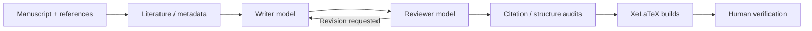

# Demo and release notes

[English README](../README.md) · [中文指南](../README.zh-CN.md)

## Demonstration workflow

This repository provides commands and output *paths*, not a validated example manuscript or benchmark result. The following is an **illustrative CLI session**, not a captured successful run.

```powershell
cd reviewforge-runtime
py reviewforge_v4.py preflight
py reviewforge_v4.py discover --minimum 60
py reviewforge_v4.py run --hours 9 --minimum 60
py reviewforge_v4.py audit --minimum 60
py reviewforge_v4.py compile
```

### What to inspect

| Artifact | Purpose |
| --- | --- |
| `workspace/reports/literature_gate.json` | Literature discovery and metadata gate |
| `workspace/reports/final_audit.json` | Citation counts and manuscript consistency |
| `workspace/reports/review_en_build.json` | English LaTeX build report |
| `workspace/reports/review_zh_build.json` | Chinese LaTeX build report |
| `workspace/output/review_en.pdf` | English PDF, if compilation succeeds |
| `workspace/output/review_zh.pdf` | Chinese PDF, if compilation succeeds |

## Architecture



## Screenshot gallery (pending real captures)

Screenshots have intentionally **not** been fabricated. When you run the project locally, you can add sanitized screenshots of preflight, revision reports, and compiled example pages to `docs/assets/`, then embed them in this page. Remove API keys, private manuscripts, names and unpublished research details first.

## Release notes

### v4 — source snapshot

- Windows v4 entrypoints and resume scripts
- DOI metadata discovery and citation audit pipeline
- Writer/reviewer collaboration and section-level LaTeX processing
- Bilingual compilation workflow and tests
- ChatGPT Skill and research review reference guides

This is a source snapshot, **not** a tagged GitHub Release or proof that the pipeline has passed an end-to-end public benchmark. Consult [runtime limitations](../reviewforge-runtime/LIMITATIONS.md) before use.
